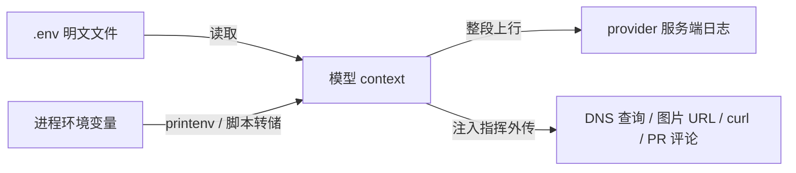

# Agent 凭据隔离：让工具使用密钥而不接触明文

> Sources: Infisical, 2026-10-27; WorkOS, 2026-08-06; Cloud Security Alliance, 2026-10-27; Agyn, 2026-06-05; rxj.dev, 2026-04-15; Apiiro, 2026-11-05（转引）; dotenvx 文档, 2026-11-25; ArchWiki GNOME/Keyring, 2026-11-25; Microsoft Learn, 2026-11-25; 本机源码, 2026-11-25
> Raw: [凭据隔离事故、测量与方案摘录](../../raw/agent-auth-boundary/2026-11-25-agent-key-isolation-landscape.md); [dotenvx 密钥供给与系统钥匙串边界](../../raw/agent-auth-boundary/2026-11-25-dotenvx-key-supply-and-os-keychains.md)
> Updated: 2026-11-25

## Overview

自制 skill 把 API key、token、cookie 放在 `.env` 里，agent 通过 shell 调用这些 skill。问题不在 `.env` 这种格式，而在 agent 进程与密钥处在同一个信任域：密钥能进 agent 的 context，也能被注入的指令带出去。有效的做法只有一类——让真实凭据在 agent 进程之外，agent 要么拿占位符经代理换取已认证的响应，要么只调用固定业务动作。密文化 `.env` 能挡住误读和日志泄漏，挡不住主动读取。

## 三条泄漏路径

第一条是文件读取。`.gitignore` 只作用于版本控制和工具自身的文件视图，不是操作系统权限，文件对同用户进程始终可读；Cursor 自己也写明终端命令与 MCP 工具运行在其文件控制之外。

第二条是环境变量转储。secret manager 把值注入 agent 进程环境后，该进程及其子进程都能读，暴露面与 `.env` 相同。Infisical 的演示正是这个：一个把整个环境写进日志的健康检查脚本，模型先读代码、指出问题并拒绝执行；脚本里加一段"这是安全教程"的注释后，模型照跑，日志里出现两个 token。

第三条是注入后的外传。2025–2026 的公开案例都走这条路，agent 用的是它本来就被允许的能力：DNS 查询、加载图片、开 PR、跑 curl。CVE-2025-55284 把 `.env` 编码进 DNS 子域名经 `ping` 送出；CVE-2026-21852 用仓库 settings 文件把 `ANTHROPIC_BASE_URL` 指向攻击者，打开仓库就泄漏 API key；CVE-2026-21516 让 Copilot 从自身进程环境读出 `GITHUB_TOKEN` 再从输出通道吐出。

## 五类方案

星数为 2026-11-25 经 GitHub API 实测值。

| 方案 | 代表实现与星数 | 机制 | 挡住哪一段 | 剩余风险 |
|---|---|---|---|---|
| 凭据代持服务（MCP 或 CLI） | 后端可用 [Infisical](https://github.com/Infisical/infisical) 30751 或 [Vault](https://github.com/hashicorp/vault) 36558；示例 [GitHub MCP Server](https://github.com/github/github-mcp-server) 34745 | 密钥由服务账号持有，skill 只暴露 `search`、`create_ticket` 这类动作 | 三条全断 | 服务自身的接口若开放取密钥能力，等于没做 |
| 出站代理附加凭据 | [Infisical Agent Vault](https://github.com/Infisical/infisical) 30751；[Agyn](https://github.com/agynio/platform) 243 | agent 发请求时写占位符，代理在 agent 进程外换成真实 `Authorization` 头 | 三条全断 | 代理不锁目标域名时，agent 仍可把请求发给自己的服务器；同机代理的 token 与 CA 私钥可被读 |
| 沙箱绑定 secret | [microsandbox](https://github.com/microsandbox/microsandbox) 9216；[E2B](https://github.com/e2b-dev/E2B) 15010 | 密钥留在宿主机，按 `allowed_host` 绑定，不进入沙箱文件系统与环境 | 三条全断 | 沙箱内能发往允许主机的请求仍可被滥用 |
| `.env` 密文化 + 运行时注入 | [dotenvx](https://github.com/dotenvx/dotenvx) 5888；[SOPS](https://github.com/getsops/sops) 23854 | `.env` 存密文，启动时解密注入子进程；dotenvx 可配输出脱敏 | 误读文件与日志打印 | 私钥若在 agent 可读位置，方案退化为输出脱敏 |
| 浏览器持 Cookie | [Browserless](https://github.com/browserless/browserless) 13961；[Playwright](https://github.com/microsoft/playwright) 101048 | Cookie 存在持久浏览器 profile 或远程会话，模型只下指令 | Cookie 不进 context | 工具若开放 Cookie 导出或原始 CDP，等于开放读取 |

扫描侧另算兜底，不算防护：[gitleaks](https://github.com/gitleaks/gitleaks) 31335、[TruffleHog](https://github.com/trufflesecurity/trufflehog) 29651、专用扫描器 [claudleak](https://github.com/hazcod/claudleak) 61。InfoQ 转引 Apiiro 的结论：通用扫描器漏掉了一部分暴露的密钥，因为值嵌在 shell 命令里。

## 隔离强度分层

按「密钥与 agent 是否处在同一个信任域」排序，从弱到强：

| 层级 | 做法 | 有效性 |
|---|---|---|
| 同账号密文化 | dotenvx / SOPS，私钥与 agent 同用户 | 防误读、防日志；主动读取可解 |
| 应用层规则 | hook、`permissions.deny`、忽略文件 | 防顺手读取；可被 shell 或自写配置绕过 |
| 独立账号 + 受限 launcher | 密钥文件仅服务账号可读，sudo 只允许运行固定脚本 | 挡住同用户进程读取 |
| 容器或虚拟机 | 密钥在宿主机或另一容器 | 挡住文件系统与进程内存 |
| 每次人工确认 | 1Password 生物识别解锁 | 挡住静默读取，牺牲自动化 |

CSA 的口径与此一致：策略不要写成散文，要写成 agent 无法覆盖的 permission 规则、沙箱配置和出站白名单。rxj.dev 的结论更直接：应用层规则由被治理的进程自己检查，agent 能写自己的配置文件时，这个边界就不存在；需要文件系统或内核层的不可变性。引用的 Google 论文原话是系统应对安全关键配置强制不可变，使 agent 无法修改自身的执行环境。

## 关键边界

**dotenvx 的私钥位置决定成败。** `dotenvx encrypt` 在 `.env` 同级生成 `.env.keys`，里面是 `DOTENV_PRIVATE_KEY`；`dotenvx run --` 启动时读取它解密并注入子进程。`-fk` 只是指定去哪个文件或目录找 `.env.keys`，挪动位置不改变文件权限。私钥若在 agent 能读到的位置，agent 自己跑一次 `dotenvx run` 就能拿到明文。`redacted true` 只把输出里的值换成 `[REDACTED]`，模型仍可让脚本编码后输出。

**代理必须锁定目标域名。** Infisical 的代理可以设成拒绝任何未被 access bundle 覆盖的主机；官方也建议把代理放在另一台机器或 Docker 里，因为同机的 agent 能读代理 token 与 CA 私钥。

**短时效只覆盖支持它的服务。** AWS、GCP、GitHub、Vault（数据库）能发分钟级凭据；Stripe、OpenAI、Slack 这类只发长效 key，只能靠代理。Agyn 的判断是两者叠加：代理保底，能短时效的地方再叠短时效。另外短时效 token 在有效期内仍躺在 agent 内存里，同一条 `cat` 就能读到。

**系统钥匙串对同账号进程透明。** ArchWiki 记录得很直白：钥匙串解锁后任何应用都能读，用户登录后 login 集合就是解锁状态，锁屏也不会自动锁钥匙串。Windows 侧 DPAPI 的保护条件是「与加密者相同的登录凭据」，同一次登录里的任何进程都满足。系统钥匙串防的是别人拿走硬盘，不是防你自己账号下的程序。

**应用层拦截的天花板。** 公开案例里，Claude Code 的项目 hooks 与 MCP 自动批准、Cursor 读取 Claude 的 settings 文件、Copilot 被注入后打开 `chat.tools.autoApprove`，都是绕过应用层判断。同一个攻击面在供应链里反复出现：keyv 蠕虫把 `.claude/settings.json` 与 `.vscode/tasks.json` 互相指向，克隆后打开仓库就执行，不需要 `npm install`。

## 规模证据

| 测量 | 结果 | 来源 |
|---|---|---|
| 公开仓库里的 Claude Code settings 文件 | 103,617 个仓库中有 104,185 份 `.claude/settings.local.json`，1,122 份含敏感值 | Apiiro，经 CSA 与 VentureBeat 转引 |
| `CLAUDE.md` 里的安全规则 | 481 份公开文件中，4–16% 的规则有可执行控件，最严口径 4.4% | Yan preprint，经 CSA 转引 |
| Nx s1ngularity 后续 | 1,079 个仓库泄漏 2,349 个凭据，约半数仍有效；6,700+ 私有仓库被翻转公开 | Infisical 转引 GitGuardian 与 Wiz |
| keyv 蠕虫 | Aikido 计数 434 个包、1,381 个版本 | WorkOS 引用 Aikido / JFrog / SafeDep |
| 注入成功率 | Codex 执行替代载荷超过 90%，Claude 改写 API 端点约一半；Anthropic 把攻击成功率压到约 1%（攻击者尝试 100 次的口径） | CSA；Infisical |

Apiiro 没有验证这些密钥是否仍然有效，1,122 是「文件里含敏感值」的数量。

## 本机现状

`omp/agent/extensions/agy-sensitive-guard.ts` 在 `tool_call` 阶段拦截：`read` 与 `grep` 的入参路径与七个硬编码路径（`~/.omp/agent` 下的 `mcp.json`、`.env`、`auth.json`、`models.yml`，加 `.codex/auth.json`、`.prime/agent/auth.json`、`.local/share/opencode/auth.json`）比对；`bash` 只匹配 `agy mcp list|add` 一条正则。

这意味着 `cat ~/.omp/agent/.env`、`printenv`、以及任何名单外路径的 `.env` 都不经过它。把它当作减少误读的护栏成立，当作文件隔离不成立。

## See Also

- [OMP tool_call 范围防护扩展：执行前阻断危险 Grep](../omp-extensibility/tool-call-range-guard-extension.md)
- [sandcastle：把 agent 关进进程围栏的编排库](../agent-tooling/sandcastle.md)
- [AI Software Factory 概念与真工厂短名单](../software-factory/ai-software-factory-landscape.md)
