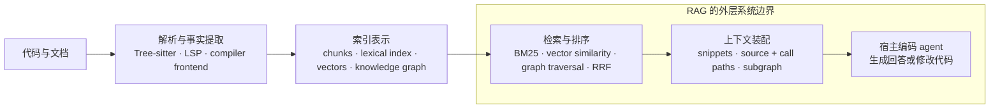

# 代码智能工具全景与选型

> Sources: CodeGraph README 与核心源码摘录, 2026-10-27; Semble README 与核心源码摘录, 2026-10-27; Graphify v8 README 与核心源码摘录, 2026-10-27; LSP / Tree-sitter / RAG / GraphRAG 官方文档摘录, 2026-10-27; OMP find cascade 源码取证, 2026-10-01
> Raw: [CodeGraph README 与核心源码摘录](../../raw/agent-tooling/2026-10-27-codegraph-readme-and-source-excerpts.md); [Semble README 与源码机制摘录](../../raw/agent-tooling/2026-10-27-semble-readme-and-source-excerpts.md); [Graphify v8 README 与核心源码摘录](../../raw/agent-tooling/2026-10-27-graphify-v8-readme-and-source-excerpts.md); [代码智能相关概念与相邻方案摘录](../../raw/agent-tooling/2026-10-27-code-intelligence-concepts-and-alternatives.md); [OMP find cascade 源码取证](../../raw/omp/2026-09-28-find-tool-cascade-source-forensics.md)
> Updated: 2026-10-27

## Overview

本文整理三个面向编码 agent 的仓库级代码理解工具：CodeGraph、Semble、Graphify。三者的共同点是都使用 Tree-sitter；差异在于索引产物和查询方式。CodeGraph 建符号图并做图遍历，Semble 建可检索片段并做 BM25 + 静态 embedding 混合检索，Graphify 建混合语料知识图谱并做词法种子加图遍历。三者都没有使用 LSP；RAG 描述的是检索结果参与宿主 agent 后续生成的外层系统行为，不概括三者的内部算法。

## 技术核对

| 技术或产物 | CodeGraph | Semble | Graphify |
|---|---|---|---|
| Tree-sitter | 提取符号与关系边 | 确定代码切分边界 | 提取代码节点和关系边 |
| LSP | 未使用 | 未使用 | 未使用 |
| BM25 | SQLite FTS5 `bm25()` | 项目自行实现 | 产品查询路径未使用 |
| embedding | 未使用 | 静态 Model2Vec | 产品查询路径未使用 |
| 图结构 | SQLite 符号图 | 没有符号图或调用图 | NetworkX 混合语料知识图谱 |
| 查询期 LLM | 没有 | 没有 | 没有 |
| 建索引期 LLM | 没有 | 正常运行没有；评测使用 | 文档、PDF、图片、转写稿的语义抽取使用 |
| 主要输出 | 相关源码、调用路径、影响范围 | 排序后的代码片段 | 可查询的知识图谱与子图证据 |

CodeGraph 的 README 说明存储使用本地 SQLite 与 FTS5 full-text search；源码核查到 `bm25(nodes_fts, 0, 20, 5, 1, 2)`。Semble 的 README 说明其检索使用 static Model2Vec embeddings 与 BM25，并通过 Reciprocal Rank Fusion（RRF）融合。Graphify 的 README 明确写着 “Not a vector index. No embeddings, no vector store: a real graph you traverse.”；v8 源码核查显示产品 Python 代码中没有 BM25。

## CodeGraph：面向结构问题的代码图谱

CodeGraph 通过 MCP 的 `codegraph_explore`、CLI 或库 API 使用。输入可以是自然语言、文件名或符号名；输出包括按文件分组的逐行源码、符号间调用路径、影响范围，以及等待同步文件的陈旧状态提示。

建索引时，Tree-sitter 提取函数、类、方法和关系边；项目自己的跨文件解析器继续处理导入绑定、接收者类型、重新导出、工作区包和框架约定，结果写入本地 SQLite。文件监听器负责增量更新。

查询时先通过精确名称、前缀和 FTS5 BM25 找候选符号，再用路径与同文件共现等信号调整排名，最后从候选符号沿图边扩展调用关系，并按字符预算装配源码、调用路径和影响范围。

适合的问题形态是“这个流程怎样运行”“修改这个函数会影响哪里”“这些变更应该运行哪些测试”。限制是：查询入口以词法匹配为主；跨文件解析是静态启发式分析；反射、运行时分发和复杂依赖注入仍可能遗漏。项目自述工具调用、处理 token 和耗时下降，同时报告多轮会话结束时驻留的检索上下文可能更多；这些数字本轮未独立复测。

## Semble：面向自然语言定位的混合代码搜索

Semble 通过 MCP 的 `search` 与 `find_related`、CLI 或 Python API 使用。输入是自然语言、代码片段或某个文件位置；输出是文件路径、行区间、分数和代码片段。

建索引时，Tree-sitter 把代码切分为约 750 字符的块；没有对应语法时退化为按行切分。每个块同时进入两套索引：静态 Model2Vec embedding 负责语义相似度，BM25 负责标识符和词面匹配。查询时两路结果经过 RRF 融合，再用定义命中、标识符词干、同文件多块、测试与示例路径等信号重排。文件修改时间变化时增量重建对应部分。

适合的问题形态是“这个功能在哪里实现”“哪个代码负责保存模型”“这段代码还有哪些相似实现”。限制是：没有持久化调用图，不能回答完整调用链和影响范围；静态 embedding 对复杂行为的理解弱于完整段落判分。README 的约 99% token 节省来自特定模拟基线，本轮未独立复测。

## Graphify：面向代码与文档的统一知识图谱

Graphify 通过 `/graphify`、CLI 或 MCP 使用。它把一个目录转换为 `graph.json`、`graph.html` 和 `GRAPH_REPORT.md`，随后支持 `query`、`path`、`explain`、`affected` 等查询。

不同输入走不同路径：代码、SQL 和配置使用 Tree-sitter 或结构化提取器；Markdown、PDF、图片和音视频转写稿除本地结构提取外，还会经过 LLM 语义提取。边带有 `EXTRACTED`、`INFERRED` 或 `AMBIGUOUS` 标记，并提供来源位置。社区由 Leiden 或 Louvain 根据连接密度识别。

查询时先分词和过滤停用词，再用 IDF、精确/前缀/子串匹配选择种子节点；字符 trigram 只做候选预筛。之后从种子节点进行 BFS 或 DFS，并限制超高度数节点的扩展，最后按 token 预算返回带来源和关系说明的子图文本。自然语言回答由宿主助手生成。

适合的问题形态是研究代码、ADR、RFC、设计文档、SQL schema 和配置之间的关系。限制是：图需要通过 `update`、`watch` 或 hook 保持新鲜；文档和图片的语义提取涉及所选模型服务的数据边界；查询是词法匹配加图遍历，问题里没有出现、也没有近义标签的概念可能找不到。

## 概念分层

这些工具可以放进同一条链路：

各层回答的问题不同：

- **Tree-sitter** 回答“源码的语法结构是什么”。它提供语法树，不负责完整类型检查与跨文件语义。
- **LSP** 回答“开发工具怎样向 language server 请求定义、引用、补全和诊断”。官方定义强调它是一套协议。
- **BM25** 回答“哪些文本在词面上更相关”。IDF 让常见词权重低，稀有且有辨识度的词权重高。
- **embedding** 回答“怎样把内容表示为向量，以便按语义距离检索”。
- **知识图谱** 回答“哪些实体存在、它们之间有什么关系”。图遍历负责沿关系寻找证据。
- **RRF** 回答“怎样融合多路检索排名”，不要求不同分数具有相同量纲。
- **RAG** 描述“检索到的内容怎样参与后续生成”。检索可以由 BM25、向量或图遍历承担。
- **GraphRAG** 在 Microsoft 的定义中还包含知识图、社区层级、社区摘要和多查询模式；图本身并不自动构成 GraphRAG。

## 相邻方案

| 方案 | 核心机制 | 与谁接近 | 主要场景 |
|---|---|---|---|
| [codebase-memory-mcp](https://github.com/DeusData/codebase-memory-mcp) | Tree-sitter + 自研类型解析 + SQLite 图 + BM25 + 内置向量 + 类 Cypher 查询 | CodeGraph、Graphify | 多语言、跨服务、代码与基础设施联合分析 |
| [GitNexus](https://github.com/abhigyanpatwari/GitNexus) | symbol / call / dependency / execution-flow 图，提供 query、impact、trace、rename | CodeGraph | 本地代码探索、影响分析和符号操作 |
| [code-review-graph](https://github.com/tirth8205/code-review-graph) | Tree-sitter → SQLite 图 → blast radius / 风险分 | CodeGraph | PR 审查、CI、修改风险分析 |
| [Serena](https://oraios.github.io/serena/01-about/000_intro.html) | 真实 language server 或 JetBrains 后端的符号导航、编辑和重构 | 相邻方案 | 引用查找、跨文件重命名、移动和其他语义修改 |
| [Claude Context](https://github.com/zilliztech/claude-context) | AST 切块 + embedding + Milvus/Zilliz + BM25 混合检索 | Semble | 自然语言代码搜索，适合已有向量服务 |
| [Code-Graph-RAG](https://github.com/vitali87/code-graph-rag) | Tree-sitter + 可选编译器前端与运行时 trace + 图数据库 + LLM 生成 Cypher | CodeGraph、Graphify | 用自然语言查询多语言仓库图 |
| [Sourcegraph](https://sourcegraph.com/docs/api/mcp) | 服务端代码搜索、SCIP 精确导航、Enterprise MCP | 相邻方案 | 企业多仓搜索、权限控制和跨仓导航 |

Serena 说明同一类工具可以完全绕开 Tree-sitter 和持久化图。Sourcegraph 说明文本搜索可以使用服务端索引，精确导航可以由编译器级符号索引支撑。

## 与 OMP `find` 的关系

OMP `find` 与 Semble 在“自然语言定位代码”上重叠，但机制不同。根据 2026-10-01 前的源码快照，`find` 先用 grep 和 IDF 权重初筛，再把候选交给 judge 做文件名、草图和完整段落判分；Semble 则预先建立静态 embedding 和 BM25 索引，查询时同时做向量召回与词法召回。

因此，两者的覆盖差别在初筛：`find` 的模型判分发生在初筛之后，初筛没有纳入的文件不会进入后续判分；Semble 的向量检索在词面没有命中时仍可能找到相关代码。反过来，`find` 的 judge 阅读候选段落，对复杂行为描述的理解可能更强。

按场景选择：

- 偶尔在 OMP 内查找功能，且 `find` 结果已经够用：继续使用 `find`。
- 高频、反复搜索相同仓库：Semble 的查询期成本低。
- 需要跨 agent、CLI、脚本或其他 MCP 客户端复用搜索入口：Semble。
- 已有代码位置，想找相似实现：Semble 的 `find_related`。
- 需要调用链和影响范围：CodeGraph。
- 需要代码与文档的统一图：Graphify。

该 OMP 对比基于 2026-10-01 前的源码快照；当前版本是否仍保持同一 cascade 和 judge 路由，本轮未复核。

## 选型小结

- 主要任务是修改跨文件逻辑，且没有更明确的痛点：先看 CodeGraph。
- 主要痛点是“我知道行为，但不知道实现在哪里”：看 Semble。
- 主要痛点是理解整个项目、文档与代码的关系：看 Graphify。
- 主要痛点是跨文件语义重构：看 Serena。
- 已经有 Milvus/Zilliz：Claude Context 可复用现有向量服务。
- 企业内跨大量仓库且必须继承权限：Sourcegraph。
- 需要代码、基础设施和文档进入同一张图：codebase-memory-mcp。

## 证据边界

- CodeGraph、Semble、Graphify 的性能与收益数字均为项目自述，本轮未独立复测。
- 本轮直读了三者的 README、依赖线索和主要索引/查询源码摘录；没有实际安装运行，也没有做同仓库同查询的命中质量对照。
- CodeGraph 快照取自 `69af19ace270f2e940444d514de6dde971df12df`；Semble 取自 `44b79754b5af5243328f65cb9f8923a55fe62f16`；Graphify 取自 `dac063456bc1f5d92354ec3936fd9dd1513a83f3`。活跃分支后续变化需要重新核对。
- CodeGraph README 在同一 commit 的直接读取观察到 916 行；调研过程中另有 1058 行的子代理报告，两者不一致。本文不使用总行数作为事实依据。
- OMP `find` 对比来自 2026-10-01 前的源码快照，当前入口未复核。

## See Also

- [graphifyy 工作机制](graphify-mechanics.md) — Graphify 早期版本的全命令清单与环境边界
- [codegraph 与 graphify 的分工边界](codegraph-vs-graphify.md) — 2026-10-07 的单查询探测与分工假设
- [OMP find 工具的 cascade 架构：lexical 粗筛 + 三波 noul 判分](../omp/find-tool-cascade.md) — OMP `find` 的机制快照
- [MCP 配置与验证阶梯](../harness-engineering/mcp-setup-validation.md) — codegraph 等 MCP 的宿主配置与验证方式
