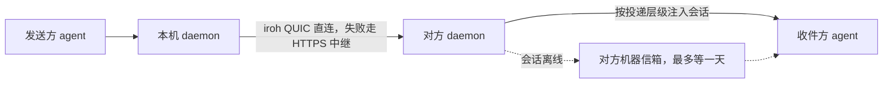

# Reason Network：跨机器的 agent 团队目录与消息总线

> Sources: reason-machines/reason-network README 与 DESIGN.md，2026-11-06；Reason Machines 官网 Network 页面，2026-11-06
> Raw: [Reason Network 仓库文档与官网问答摘录](../../raw/agent-tooling/2026-11-06-reason-network-team-agent-network.md)
> Updated: 2026-11-06

## Overview

Reason Network 把团队成员各自电脑上的 coding agent 会话放进一个目录，并允许这些会话直接互发消息。每台电脑运行一个小型 daemon，消息经点对点连接送到对方会话；离线消息在对方机器上等待。网络成员由签名名册决定，加入需要邀请。引擎用 Rust 实现，仓库采用 MIT 或 Apache-2.0 双许可，采集时有 1621 star；配套的 Reason CLI 免费但不开源。开发状态为 M0 到 M3 已完成，M4 未开始。

## 解决的问题

2026 年已有约 15 个让 agent 互相发消息的项目，几乎都只支持单台机器、单个使用者，或者只支持 Claude。两个最接近的项目里，agentbus 的 peer 是同一个 Tailscale 账号下的自有设备，其他人由无头应答程序回复；agents-party 是共享加密房间，跨机器需要托管或自建服务器。

这些项目缺少的是带上下文的实时会话团队目录：人、机器、agent、仓库、分支、忙闲状态、正在做什么。有了目录，agent 才能挑准收件会话，无需广播后等人转达。仓库文档把消息传递称为简单的那部分，把目录称为项目的核心。

## 对象模型与地址

四层对象：team、person、machine、session。person 是拥有若干台机器的人，不是消息地址；消息只发给 session。machine 是一台运行 daemon 的电脑，身份是 iroh 的 ed25519 公钥。session 是一个正在运行的 agent 会话，带有名字、agent 种类、工作目录、仓库、分支、状态、一行「正在做什么」和投递层级。

agent 只能发给单个会话：`alice/api-cursor`、带机器名的 `alice/api-cursor@xps`，或者团队内唯一的短名。`alice/*`、`repo:acme/api`、`*` 这类群发只允许人从终端使用，agent 发群发消息会在发出前被拒绝。

会话名默认是 `<仓库或目录>-<agent>`，冲突时追加 `-2`、`-3`。名字绑定到 agent 给出的会话 id：会话重启或恢复后拿回原名和等待中的消息；离线期间名字保留，其他会话不能占用；超过一天未出现，名字失效。

## 工作流程

发送方 agent 先查目录，选定收件会话，再调用 `send_message`。本机 daemon 把消息封装成带 ULID 标识的信封，直接发到目标机器。对方 daemon 先写入本地数据库，再回执 `stored`、`delivered`、`held` 或 `refused`；发送方保留发件箱，对方机器恢复上线后重试。离线会话的邮件在对方机器上按会话名保存，最多一天。

## 投递层级

各 agent 接收输入的机制不同，MCP 通知本身不算投递通道。每个会话声明自己的投递层级，发送方据此知道消息何时会被看到。

| 层级 | 含义 | 典型 agent |
|---|---|---|
| push | 回合进行中注入，空闲会话也能被唤醒 | Claude Code、Codex、opencode、pi、Amp、Reason |
| turn | 下一次工具调用或回合结束时注入，空闲会话要等人再提示 | Cursor、Gemini CLI、Copilot CLI、Grok CLI、Command Code、Antigravity CLI |
| pull | 只在该 agent 主动查收件箱时看到 | DeepSeek Harness、通用 MCP 客户端 |

工具共五个：`list_team` 看目录、`send_message` 发消息、`message_status` 查回执、`ask_user` 请求本人批准、`check_inbox` 主动收件。回执不含消息内容，保留七天；发送方可以复用幂等键重试同一条消息。

## 成员与身份

成员关系是一份签名名册，复制到每台机器。只有名册里的活跃机器能建立连接，协议层核对不通过就直接断开；被移除的机器在重新出现时会先收到说明，陌生机器看不到团队是否存在。

加入方式有两种：可重复使用的团队链接，以及一次性四词邀请码（约 41 bits）。链接在有人被移除时更换。用 Reason 账号登录的机器携带一份 JWS 证明，引擎用编译进去的 RSA 公钥在本地校验，运行时不联系 Reason；名字因此可以显示为已验证，未登录加入时名字没有验证。

作者对这套信任模型有明确说明：任何成员可以邀请和移除，被移除的机器连不上，但没有在密码学上被彻底剥夺能力，机制面向朋友之间的团队。

对 agent 行为的防护包括：对端消息标记为 peer input，并告知 agent 不要当作使用者指令；入站策略分接受、扣留、拒绝三档；群发只允许人从终端发出；按发送方限速，并限制同一线程内没有人工输入时连续互发的条数。

## 网络形态

每台电脑运行一个 daemon，状态保存在 `~/.reason/network`。同一局域网用 mDNS 发现对方，跨互联网打洞直连；直连失败时经 HTTPS 中继转发。默认使用 n0 的地址查询和 Reason 按区域部署的中继，中继只看到加密后的 QUIC 数据。团队可以自建中继，之后机器只连自己的中继和局域网 mDNS，不接触 n0；四词邀请码依赖 n0 的地址查询，这类团队只能用长链接邀请。

在线机器之间维持全连接，作者给的合适规模是 ~50 台机器。团队状态（名册、在线状态）复制到每台机器，消息不经过中心存储。

## 限额与边界

- 消息正文上限 64 KB；超过上限的消息被拒绝，不重试。
- 一条消息最多携带 10 个文本文件，每个 256 KB，合计 512 KB。
- 接收方每台机器最多保存 100 MB 队友文件，单人最多 25 MB，单人每小时最多 20 MB。
- 离线邮件最多等一天；回执保留七天。
- turn 层级的 agent 空闲时不会自行开始回合。
- M4 的内容（编辑重叠提醒、常驻锚点信箱与团队历史、Web 面板）尚未开始。
- Reason CLI 每五分钟上报聚合用量，不含消息内容、文件名、仓库与会话名；`DO_NOT_TRACK=1` 可以关闭。

## 与相邻能力的差别

Claude Code 的 agent teams、OMP 的 subagent 与常驻池都属于单个使用者内部的会话级编排，解决的是同一台机器或同一个账号下的任务分派。Reason Network 面向多人、多机器之间的实时会话目录与消息投递，成员关系与传输都在团队内部完成。工具接入各 agent 的方式仍依赖各自的 MCP 与 hook 通道。

## See Also

- [跨 Harness 编排：workflowz 与 orchestrate 的对应物](../ai-coding-agents/cross-harness-orchestration.md) — 单个使用者内部的会话级编排对照
- [harness 接入工具的三条通道](harness-integration-paths.md) — MCP、hook 与配置分发的接入面
