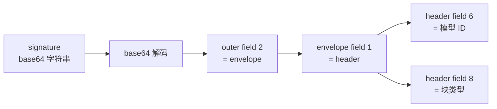

# 用 Anthropic thinking signature 判断网关实际服务的模型

> Sources: OMP `pi-ai` 源码 `src/providers/anthropic-signature.ts`（18.12.6）, 2026-10-26; 真实 Opus 5 signature 样本实验记录, 2026-10-05; 解析函数的样本测试记录, 2026-10-05
> Raw: [源码核对](../../raw/omp-signature-verification/2026-10-26-anthropic-signature-source-review.md); [真实 Opus 5 样本](../../raw/omp-signature-verification/real-opus5-signature.md); [解析函数样本测试](../../raw/omp-signature-verification/omp-parser-analysis.md)
> Updated: 2026-10-26

## Overview

Anthropic 的 thinking block 带 `signature` 字段，它是 base64 编码的 protobuf，其中有一段明文头，头的 field 6 写着实际产出这段内容的模型 ID。OMP 用 `servedModelFromAnthropicSignature` 把这个字段读出来，用 `isAnthropicNarrationSignature` 读 field 8 判断块的类型。这给出一条从响应当中核对「网关服务的模型是不是你请求的模型」的通道。

## 明文头结构

| 层级 | 字段 |
|---|---|
| outer | 1 版本；2 envelope |
| envelope | 1 header；2-5 nonce、ciphertext、tag |
| header | 1 schema；5 hash；6 model；8 kind；11 org uuid；15 profile；21 unix ts |

field 6 写的是具体快照名（如 `claude-haiku-4-5-20251001`）或内部代号（如 `numbat-v6-…`）。field 8 写块类型，`thinking` 表示推理，`narration` 表示模型在工具调用之间写给用户的叙述。

## 解析流程

1. `signature.length < 8` 直接返回 `undefined`。
2. base64 解码，解码抛错返回 `undefined`。
3. 在解码结果里找 outer 的 field 2，得到 envelope。
4. 在 envelope 里找 field 1，得到 header。
5. 在 header 里找 field 6，得到模型 ID 的字节。
6. 字节为空或长度超过 128 返回 `undefined`。
7. UTF-8 解码后必须匹配 `^[A-Za-z0-9][A-Za-z0-9._:/-]*$`，否则返回 `undefined`。

字段遍历由 `lengthDelimitedField` 完成：wireType 0 跳过 varint，1 跳 8 字节，5 跳 4 字节；wireType 2 读出长度，字段号命中时返回该段字节，否则跳过；其他 wireType 返回 `undefined`。tag 与 length 超出 uint32 时同样返回 `undefined`。整条链上没有长度上限：长回复的 narration signature 会超过 13k 字符。

## 两种调用入口

`servedModelFromAnthropicSignature(signature)` 直接吃 Anthropic 的 signature 字符串。

`servedModelFromOpenRouterReasoning(item)` 吃 OpenRouter 的 `reasoning_details` 条目，要求 `format === "anthropic-claude-v1"` 且 `signature` 为字符串，再转调前者。

OMP 在 `anthropic.ts` 里把结果写在 `output.upstreamModel`，同时用 `isAnthropicNarrationSignature` 给块打 `narration` 标记。

## 判断网关是否换了模型

请求模型 A，响应的 thinking block 里 field 6 读出 B，说明产出这段内容的是 B。源码注释把这条用途写明：一个服务了不同模型的网关无法凭空造出写着 A 的 header。

版本 4 的外层格式（前缀 `CAQS…`）带的 header 不含 field 6，解码器返回 `undefined`。这类响应在 OMP 里表现为 `upstreamModel` 为空。

## 返回 undefined 的几种原因

- signature 不是合法 base64，或短于 8 个字符。
- 在解码结果里找不到 outer 的 field 2，或在 envelope 里找不到 field 1。
- header 里没有 field 6，常见于版本 4 格式。
- field 6 的字节为空、超过 128 字节，或字符集不匹配模型 ID 的形态。

这些情况下这条通道得不出结论，需要改用 usage 计量、模型自报名或其他字段判断。

## 方法边界

函数只读明文头。signature 的密文部分是否由 Anthropic 密钥签发，这个函数不做校验。用它判断模型身份时，前提是 header 没有被中途改写。

本机样本：一个真实 Opus 5 signature 长 274 bytes，首字节 `0x08`（field 1、wireType 0），解析结果为 `claude-opus-5`。其他模型（Sonnet、Haiku）与非标准结构的样本未测。

## See Also

- [Gateway catalog 是客户端配置的权威源](gateway-catalog-as-config-authority.md) — 目录字段与实际服务能力不一致时的取值来源
- [JustWoker `/v1/messages` 实测行为](justwoker-v1-messages-observed-behavior.md) — 请求模型名与返回模型的对照观测
- [模型 capability 与 gateway wire 参数不一致](reasoning-capability-vs-wire-parameter.md) — 能力声明与实际 wire 参数的分离
