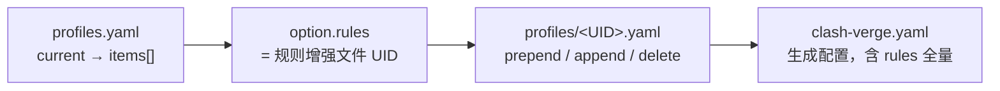

# 域名定向代理规则：把指定域名固定到代理组

> Sources: Clash Verge Rev Docs, Unknown; mihomo docs, Unknown; 本机 Clash Verge Rev 2.5.8 与 mihomo 运行配置实测, 2026-10-26
> Raw: [Clash Verge Rev 域名定向规则与本机核对摘录](../../raw/proxy-ops/2026-10-26-domain-rule-clash-verge-rev.md)
> Updated: 2026-10-26

## Overview

要让某个域名稳定走代理，做法是在订阅的规则增强文件里加一条前置 `DOMAIN` 规则，第三项填代理组名称。规则把连接交给该组，再使用该组当前选中的节点，因此组内切换节点不需要改规则。第三项填节点名称时，连接固定到那个节点，不跟随选择。规则按从上到下的顺序匹配，命中第一条即停止，所以前置位置决定它是否被订阅自带的规则抢先。

## 规则语义

`DOMAIN` 匹配完整主机名，不做后缀扩展。`DOMAIN-SUFFIX` 才匹配子域。要覆盖下载过程可能跳转的其他主机名，需要按实际连接记录补规则。

匹配顺序在两个层面一致：mihomo 内核自上而下匹配、顶部优先；Clash Verge Rev 的界面说明同样写明「规则从上到下依次匹配，匹配到第一条符合条件的规则后停止」。

插入位置分前置与后置。前置规则排在订阅规则之前，优先级最高；后置规则在订阅规则之后生效。界面文档推荐使用前置规则。

第三项可填 `DIRECT`（直连）、`REJECT`（阻断）或代理组名称。填组名时，该组当前选中的节点决定实际出口；组内如果包含 `DIRECT` 作为可选项且当前选中它，规则会走直连。

## 配置位置

界面入口：在配置文件的订阅条目上右键，选择「编辑规则」。界面文档明确说明此处编辑的规则不会随订阅更新失效。

文件层有三段关联：



- `profiles.yaml` 的 `current` 指向当前条目，该条目的 `option.rules` 是规则增强文件的 UID。
- 规则增强文件顶层就三个键：`prepend`、`append`、`delete`。界面里的「前置规则」对应 `prepend`，「后置规则」对应 `append`。
- 生成给内核的配置是 `clash-verge.yaml`，`rules` 在里面是完整列表；同目录的 `config.yaml` 的 `rules` 为空，不能用它判断规则。

本机核对：`option.rules` 为 `rNBxcSZKEHaF`，对应 `profiles/rNBxcSZKEHaF.yaml`，`prepend` 有 2 条；`clash-verge.yaml` 含 627 条规则。controller 为 `127.0.0.1:9097`，`mixed-port` 为 `7897`。

## 组名与节点名

本机同一个 `prepend` 列表里两种写法并存，可以直接对照：

```yaml
prepend:
  - DOMAIN,vscode.download.prss.microsoft.com,红魔馆网络
  - DOMAIN,agents.stackoverflow.com,日本01-海外中转-0.6倍率
```

第一条第三项是组名 `红魔馆网络`，类型为 `select`，`proxies` 列表不含 `DIRECT`。这个组当前选中 `香港07-晚高峰分流-海外中转`，该节点运行时类型为 `AnyTLS`。在这里换组内节点，规则自动跟随。

第二条第三项是节点名 `日本01-海外中转-0.6倍率`，锁定到该节点，与任何组的选择无关。

选择依据：需要保留手动切换能力时填组名；需要无论组怎么选都固定出口时填节点名。

## WSL 到 mihomo 的路径

本机 WSL 使用 `mirrored` 网络模式，六个代理环境变量（`HTTP_PROXY`、`HTTPS_PROXY`、`ALL_PROXY` 及小写形式）全为空，`ip route get 1.1.1.1` 经 `198.18.0.2 dev eth1`。宿主的 `Mihomo` 网卡状态为 `Up`，系统代理开关 `proxyEnable` 为 `0`，默认路由首条为 `Mihomo nextHop=198.18.0.2`。

含义：WSL 里没有代理环境变量也会经过 mihomo。内核侧 `mode` 为 `rule`，`tun.enable` 为 `True`，`tun.stack` 为 `gvisor`，宿主系统代理开关为 `0`，流量经 TUN 路由。WSL 内访问 `127.0.0.1:7897` 可用，说明 mirrored 模式下 loopback 与宿主共享。

因此在这台机器上，域名规则的生效范围覆盖 WSL 内的程序，不需要额外设置代理变量。

## 核对方法

controller 需要鉴权：不带 `Authorization: Bearer <secret>` 请求 `/configs` 得 `HTTP 401 Unauthorized`。secret 在 `clash-verge.yaml` 里。

`GET /rules` 返回内核实际加载的规则与顺序。本机返回 627 条，前三条：

```text
0 | Domain | vscode.download.prss.microsoft.com | 红魔馆网络
1 | Domain | agents.stackoverflow.com | 日本01-海外中转-0.6倍率
2 | DomainKeyword | openai | 💬AI代理
```

目标规则在第 0 位，说明它没有被订阅规则抢在前面。

`GET /connections` 用来确认单条连接的命中情况。一次经 `127.0.0.1:7897` 的 CONNECT 隧道（响应 `HTTP/1.1 200 Connection established`）对应记录为 `rule=Domain`、`rulePayload=vscode.download.prss.microsoft.com`、`chains=["香港07-晚高峰分流-海外中转", "红魔馆网络"]`，即先经组再经该节点。

界面侧对应位置是连接的规则与链路显示。

## 证据边界

规则已加载有两处依据：生成配置 `clash-verge.yaml` 的第 0 条，以及 `/rules` 的第 0 条。连接命中只有一次隧道观察，未做重复测量。要进一步确认长期行为，可以在一段时间内多次采样 `/connections` 的 `chains`，检查是否持续显示 `红魔馆网络` 与该节点。

订阅更新后规则文件的保留行为来自界面文档的说明，本机未做更新触发验证。若下载过程跳转到其他主机名，那些连接按各自规则处理，不受这条 `DOMAIN` 规则覆盖。

## See Also

- [LLM API SSE 流式调用：Clash Verge/mihomo + 机场链路的机制、影响与配置](../llm-proxy-sse/llm-api-sse-proxy-chain.md) — select 组固定出口对长连接的意义
- [专有代理客户端迁移到标准 Clash：通用取证方法](proprietary-client-to-clash-migration.md) — 本机订阅形态来源
- [代理出口 IP 指纹批量测量与形态分类](exit-ip-fingerprint-measurement.md) — 同用 controller 与 secret，以及切换组内节点时的测量注意事项
