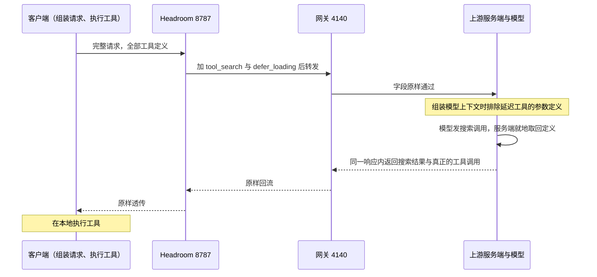

# Responses API 工具 schema 延迟加载：线格式、注入门与实测收益

> Sources: 本机 8787/4140 HTTP 探测 + headroom-ai 0.42.0 源码, 2026-11-06
> Raw: [2026-11-06-tool-search-defer-loading-probe](../../raw/responses-api/2026-11-06-tool-search-defer-loading-probe.md)
> Updated: 2026-11-06

## Overview

Responses API 支持把工具的参数定义挡在模型上下文之外，模型需要时先搜索、再调用。请求侧要两个字段成对出现：一个 `tool_search` 工具加每个待延迟工具的 `defer_loading` 标记，单独使用任一字段都会被上游 400。Headroom 会在满足三道门时代为注入；本机实测上游接受，40 个长描述工具从 4,949 降到 3,601 input token。

## 线格式

| 请求形态 | 结果 |
|---|---|
| 只加 `tool_search` | 400，`tools.tool_search requires at least one deferred tool` |
| 只加 `defer_loading` | 400，`Deferred tools require tools.tool_search` |
| 两者成对 | 200 |

合法组合下，请求体比全量形态更大（多了搜索工具与标记），而 input_tokens 更小。

## 注入的三道门

| 门 | 条件 |
|---|---|
| 工具数量 | 至少 12 个 |
| 客户端 | 不是 codex，也不是 opencode |
| 模型版本 | 主版本 ≥ 5.4 |

任一不满足就不注入，请求原样发出。客户端判定中 `X-Client` 头优先于 User-Agent；识别不到的调用方在 `/v1/responses` 路径上会被当作 codex。

两个被排除的客户端各有自身缺陷：Codex 客户端在往返中丢失延迟工具的命名空间，OpenCode 会把注入的搜索工具当成不可用工具报错。

## 实测收益

| 工具集 | 全量 input | 延迟 input | 差值 |
|---|---|---|---|
| 12 个极简工具 | 365 | 721 | +356 |
| 40 个工具（tools 数组 34,180 字节） | 4,949 | 3,601 | −1,348（约 27%） |
| 40 个工具（较短描述） | 3,112 | 2,605 | −507 |

搜索工具自身约 350 token 固定开销，工具定义体积低于它时延迟更贵。缓存命中的请求里，延迟形态的 cached_tokens 同样下降。

## 一次延迟调用的往返

模型看到的是工具名与描述，参数定义不在上下文里。需要某工具时，它先发一条搜索调用，名称写在参数里。

实测输出项序列为 `tool_search_call`、`tool_search_output`、`reasoning`、`function_call`。搜索发生在服务端，客户端不参与；工具执行仍在客户端本地。单轮因此多约 266 token。

## 客户端与上游的接受面

本机能联系上的 GPT 模型全部接受这对字段，包括低于 5.4 的 gpt-5.3-codex；三个返回 502 的模型是无实例可服务，与字段无关。

尚未验证：客户端收到 `tool_search_call`、`tool_search_output` 两类条目时的处理，以及它们随历史进入后续请求后的行为；客户端实际发出的工具定义 token 体积。

## See Also

- [Responses API web_search usage 计量](web-search-usage-forensics.md)
- [Headroom 0.42 设置项地图](../agent-tooling/headroom-042-settings-map.md)
